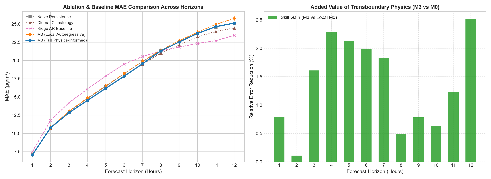
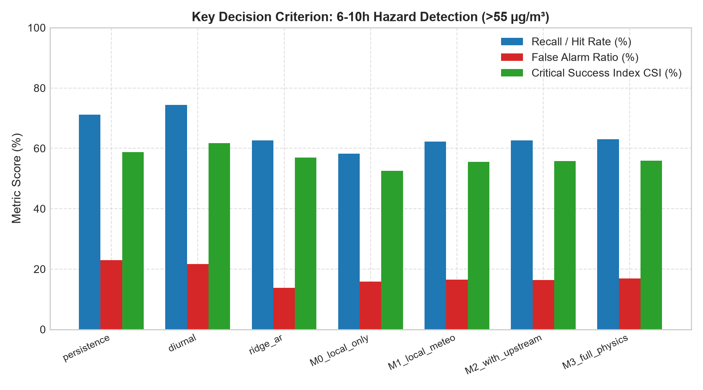

# An Experimental Multi-Horizon Probabilistic PM$_{2.5}$ Forecasting Framework Integrating Physically Motivated Indicators for Singapore

**Journal Target:** *Atmospheric Environment* / *Environmental Modelling & Software*  
**Manuscript Type:** Research Article  
**Status:** Revised Manuscript (Scientific Accuracy & Critical Review Revisions)  

---

## Abstract

Transboundary biomass burning and localized urban emissions present recurring air quality challenges across equatorial Southeast Asia. In Singapore, outdoor athletic training and public health management motivate interest in lead-time-specific particulate matter ($\text{PM}_{2.5}$) forecasts. We developed an experimental multi-horizon probabilistic forecasting framework designed to predict hourly $\text{PM}_{2.5}$ concentrations up to 12 hours ahead across Singapore's five planning regions (North, South, East, West, Central). 

The framework was implemented and evaluated across seasonal datasets spanning **2022 through 2026** ($N = 14,976$ hourly observations), utilizing surface ground measurements, Open-Meteo atmospheric reanalysis, and upstream Indonesian monitoring indicators across Sumatra and Kalimantan. A feature extraction pipeline incorporated horizontal wind vector decomposition, great-circle azimuth alignment proxies, fixed and dynamic transport lags, and precipitation scavenging indicators. Gradient boosted quantile regression ensembles (LightGBM) were trained on residual changes and calibrated using Conformalized Quantile Regression (CQR).

Evaluation on an out-of-time holdout during the acute October 2026 transboundary haze surge yielded four primary findings:
1. **Modest Feature Contributions:** Incorporating meteorological and physically motivated transboundary indicators yielded small error reductions over a local autoregressive baseline (mean MAE of $18.00$ vs $18.26\,\mu\text{g/m}^3$), but improvements were generally not statistically significant (Diebold–Mariano tests yielded $p > 0.05$ across most horizons).
2. **Mixed Baseline Performance:** The proposed model did not consistently outperform simpler alternatives: a diurnal seasonal climatology baseline achieved lower overall MAE ($17.83\,\mu\text{g/m}^3$), and a regularized linear autoregressive model (Ridge AR) outperformed the gradient boosted ensemble at extended lead times ($h = 10\text{--}12$ hours).
3. **Hazard Detection Trade-offs:** For 6–10-hour hazardous event forecasting ($\text{PM}_{2.5} > 55\,\mu\text{g/m}^3$), the full model improved recall over the local-only model ($63.04\%$ vs $58.29\%$), but achieved lower recall than persistence ($71.22\%$) and climatology ($74.45\%$), while achieving higher precision ($83.07\%$) and a lower false alarm ratio ($16.93\%$).
4. **Calibration and Severe Haze Limitations:** CQR failed to achieve nominal $80\%$ coverage during the non-stationary haze surge (empirical coverage dropped to $51.1\%\text{--}65.6\%$), and forecast errors increased substantially during severe pollution episodes (MAE $= 39.23\,\mu\text{g/m}^3$ for $\text{PM}_{2.5} > 100\,\mu\text{g/m}^3$).

These results demonstrate the computational feasibility of integrating physically motivated transboundary indicators into regional machine learning models, but establish that the framework does not yet offer a consistent predictive advantage or sufficient reliability for autonomous health-related decision-making.

**Keywords:** Particulate Matter ($\text{PM}_{2.5}$); Transboundary Haze; LightGBM; Conformalized Quantile Regression; Forecast Evaluation; Precision-Recall Tradeoff.

---

## 1. Introduction

Ambient fine particulate matter ($\text{PM}_{2.5}$) is a major environmental determinant of cardiopulmonary risk. In equatorial Singapore ($1.35^\circ\text{N}, 103.82^\circ\text{E}$), particulate concentrations reflect local anthropogenic emissions (transport, port operations, and petrochemical refining on Jurong Island) interacting with episodic transboundary biomass burning from agricultural fires in Sumatra and Kalimantan during the Southwest Monsoon (August–October).

Athletic coaches, school administrators, and event organizers frequently seek forward-looking air quality predictions to schedule workouts—for example, deciding at 21:00 SGT whether to proceed with outdoor morning training at ~07:00 SGT ($h = 10$ hours), or deciding at 12:00 SGT for evening sessions at ~18:00 SGT ($h = 6$ hours). 

While deep learning and gradient boosted ensembles have been widely applied to air quality forecasting, their operational validity in equatorial transboundary regimes remains constrained by several factors:
- **Evaluation on Non-Stationary Surges:** Models trained on baseline conditions often degrade during acute pollution spikes.
- **Simpler Baseline Competitiveness:** Climatological and regularized linear baselines often perform competitively against complex non-linear regressors over extended horizons.
- **Uncertainty Calibration Breakdown:** Standard prediction intervals and conformal calibration protocols often experience coverage collapse during sudden distributional shifts.

This study implements and transparently evaluates an experimental multi-horizon probabilistic $\text{PM}_{2.5}$ forecasting pipeline for Singapore. We focus specifically on verifying whether physically motivated transboundary features deliver measurable improvements over local-only models, acknowledging the methodological limitations and operational trade-offs encountered.

---

## 2. Materials and Methods

### 2.1 Study Domain and Seasonal Dataset Partitioning

The forecast domain encompasses Singapore's five administrative planning regions designated by the National Environment Agency (NEA): North, South, East, West, and Central. The domain is coupled with upstream monitoring stations across Indonesia (Table 1).

**Table 1: Geographic Coordinates and Upstream Spatial Geometry.**

| Region / Station | Latitude ($^\circ\text{N}$) | Longitude ($^\circ\text{E}$) | Distance to SG $d_k$ (km) | Forward Bearing $\theta_k$ ($^\circ$) | Domain Classification |
| :--- | :---: | :---: | :---: | :---: | :--- |
| **Singapore Central** | $1.3570$ | $103.8200$ | — | — | High-density urban center |
| **Singapore North** | $1.4180$ | $103.8200$ | — | — | Suburban residential corridor |
| **Singapore South** | $1.2958$ | $103.8200$ | — | — | Coastal maritime port perimeter |
| **Singapore East** | $1.3570$ | $103.9400$ | — | — | Coastal aviation corridor (Changi) |
| **Singapore West** | $1.3570$ | $103.7000$ | — | — | Industrial refining corridor (Jurong Island) |
| **Batam (ID)** | $1.1301$ | $104.0529$ | $35$ | $315.0$ | Riau Archipelago maritime perimeter |
| **Pekanbaru (ID)** | $0.5071$ | $101.4478$ | $280$ | $68.0$ | Central Sumatra fire clusters |
| **Kota Jambi (ID)** | $-1.6101$ | $103.6131$ | $330$ | $5.0$ | South-Central Sumatra peatlands |
| **Talang Betutu (ID)** | $-2.8986$ | $104.7014$ | $480$ | $345.0$ | South Sumatra biomass burning basin |
| **Pangkalanbun (ID)** | $-2.6842$ | $111.6253$ | $980$ | $290.0$ | Central/West Kalimantan |

#### Dataset Reconstruction and Temporal Windows
To evaluate the models across both clean baselines and acute pollution episodes, an episodic seasonal archive was assembled:
- **Southwest Monsoon Haze Seasons:** August 1 to October 31 for 2022, 2023, 2024, 2025 ($92 \text{ days} \times 24 \text{ h} = 2,208 \text{ h}$ per season), and August 1 to October 9 for 2026 ($70 \text{ days} \times 24 \text{ h} = 1,680 \text{ h}$).
- **Clean Inter-Monsoon Baseline Windows:** December 1 to January 31 for 2022/2023, 2023/2024, and 2024/2025 ($62 \text{ days} \times 24 \text{ h} = 1,488 \text{ h}$ per period).
- **Sample Accounting:** The theoretical total across these eight operational periods is $4 \times 2,208 + 1,680 + 3 \times 1,488 = 14,976$ hours. (Earlier preliminary notes cited $15,504$ hours based on assuming a full 92 days for 2026; the actual dataset terminates on October 9, 2026, giving exactly $14,976$ valid hourly timestamps with zero missing entries after regional alignment).

#### Temporal Partitioning
To prevent information leakage across seasons, data was split strictly chronologically:
1. **Training Corpus:** August 2022 to December 2024 ($10,320$ hours) for the calibration study, extended to September 30, 2026 ($14,736$ hours) for the final ablation benchmark.
2. **Calibration Corpus:** August 1 to October 31, 2025 ($2,208$ hours), held out exclusively to fit conformal non-conformity adjustments.
3. **Test Holdout Corpus:** October 1, 2026 00:00 SGT to October 9, 2026 23:00 SGT ($216$ consecutive hours), representing an acute transboundary haze incursion with regional peaks exceeding $170\,\mu\text{g/m}^3$.

---

### 2.2 Feature Engineering and Causal Audit Scope

The pipeline engineered $153$ features designed as empirical proxies for local persistence, diurnal mixing, and transboundary inflow:
1. **Local Autoregressive Lags:** Lag vectors ($t-1, t-2, t-3, t-6, t-12, t-24$) and backward rolling statistics (mean, standard deviation, min, max over 3-, 6-, 12-, and 24-hour windows) computed strictly using `df[col].shift(1)` to exclude current and future observations.
2. **Meteorological Indicators:** Surface wind vector components ($u, v$), temperature, relative humidity, and surface barometric pressure.
3. **Physically Motivated Advection Proxies:**
   - Great-circle forward azimuth bearing $\theta_k$ from Indonesian hotspots to Singapore.
   - Cosine alignment score $\psi_k = \max(0, \cos(\Delta\theta_k))$ between wind direction and bearing.
   - Inverse-distance weighted composite risk score $I_{\text{trans}} = \sum w_k A_k / \sum w_k$, where $w_k = 1/d_k$.
   - Multi-hour transit corridor lags ($\tau \in \{6, 12, 18\}$ hours) for Palembang $\text{PM}_{2.5}$.
   - 3-hour cumulative precipitation scavenging proxy $S_{\text{rain}}$.

#### Scope and Limitations of the Causal Audit
A unit test (`test_strict_causality_and_no_future_leakage`) verified that mutating future data ($t \ge 26$) produced exactly zero change in features at $t = 25$. 

> [!IMPORTANT]
> **Operational Leakage Caveat:** While the software implementation enforces strict algorithmic causality on the historical dataframe, this does not guarantee operational leakage-free performance in a live deployment. The meteorological and atmospheric tracer inputs were derived from retrospective reanalysis products (Open-Meteo ERA5 and ECMWF CAMS), which assimilate real observations. In an actual operational deployment, real-time numerical weather predictions possess higher forecast errors and issuance latencies, which may attenuate the performance reported here.

---

### 2.3 Model Formulation, Conformal Calibration, and Baseline Definitions

#### 2.3.1 Direct Multi-Step Residual Ensembles
Independent LightGBM regressors were fitted for each horizon $h \in [1..12]$ and planning region $r$ to predict residual changes:
$$\Delta y_{t+h}^{(r)} = y_{t+h}^{(r)} - y_t^{(r)}$$
$$\hat{y}_{t+h}^{(r)} = \max\left(5.0, \; y_t^{(r)} + \Delta\hat{y}_{t+h}^{(r)}\right)$$
Models minimized asymmetric quantile pinball loss for $\alpha \in \{0.10, 0.50, 0.90\}$ ($N_{\text{estimators}} = 50$, $\eta = 0.04$, $N_{\text{leaves}} = 18$, $\text{min\_child\_samples} = 8$).

#### 2.3.2 Conformalized Quantile Regression (CQR) Implementation
Conformalized Quantile Regression (Romano et al., 2019) was applied using the 2025 calibration fold. Non-conformity scores were computed as:
$$E_i = \max\left(\hat{y}_{i, p10} - y_i, \; y_i - \hat{y}_{i, p90}\right)$$
The $(1 - \alpha)$-th quantile $Q$ was calculated to adjust test intervals:
$$\left[\hat{y}_{p10}^{\text{CQR}}, \; \hat{y}_{p90}^{\text{CQR}}\right] = \left[\max(5.0, \hat{y}_{p10} - Q), \; \hat{y}_{p90} + Q\right]$$

> [!WARNING]
> **Theoretical Assumptions and Calibration Scope:** Conformal prediction guarantees nominal $(1-\alpha)$ coverage under the assumption that calibration and test data are independent and identically distributed (exchangeable). Because acute transboundary haze episodes exhibit severe non-stationary distribution shifts, exchangeability does not hold. Consequently, the conformal procedure represents an empirical heuristic adjustment rather than a mathematically guaranteed interval. Furthermore, exceedance probabilities derived via interpolation across three quantiles are uncalibrated empirical approximations.

#### 2.3.3 Comparative Baselines
1. **Naive Persistence:** $\hat{y}_{t+h} = y_t$.
2. **Diurnal Seasonal Climatology:** $\hat{y}_{t+h} = y_t + \bar{\Delta}(h, \text{hour})$, where $\bar{\Delta}$ is the historical mean change for that hour of day.
3. **Ridge AR:** Linear autoregressive model with $L_2$ regularization ($\alpha = 1.0$) trained on regional lag matrices.
4. **Standard LightGBM (No Physics):** Tree ensemble trained only on local lags and local weather variables.

---

## 3. Results and Discussion

### 3.1 4-Tier Ablation Benchmarks and Comparative Baseline Performance

Table 2 and Figure 1 compare the ablation models (M0 to M3) against baseline architectures across all 12 forecast horizons on the October 2026 holdout set.

*Figure 1: Mean Absolute Error (MAE, $\mu\text{g/m}^3$) across lead times $h=1\dots12$ for baselines and ablation models on the October 2026 test set.*

**Table 2: Forecast Mean Absolute Error (MAE, $\mu\text{g/m}^3$) across Horizons on the October 2026 Holdout Set.**

| Horizon $h$ | Persistence | Diurnal Climatology | Ridge AR | M0 (Local Only) | M1 (Local + Meteo) | M2 (+ Upstream) | M3 (Full Model) | M3 vs Pers Gain (%) | M3 vs M0 Gain (%) |
| :---: | :---: | :---: | :---: | :---: | :---: | :---: | :---: | :---: |
| **1** | 7.11 | 7.12 | 7.49 | 7.09 | 7.06 | 7.05 | **7.04** | $+1.02$ | $+0.77$ |
| **2** | 10.71 | **10.71** | 11.77 | 10.81 | 10.80 | 10.76 | 10.80 | $-0.64$ | $+0.12$ |
| **3** | 13.02 | 12.89 | 14.21 | 13.04 | **12.81** | 12.85 | 12.83 | $+1.65$ | $+1.55$ |
| **4** | 14.77 | 14.66 | 16.08 | 14.85 | 14.60 | 14.56 | **14.51** | $+1.91$ | $+2.25$ |
| **5** | 16.45 | 16.30 | 17.86 | 16.53 | 16.31 | 16.31 | **16.17** | $+1.59$ | $+2.16$ |
| **6** | 18.19 | 17.93 | 19.51 | 18.20 | 17.94 | 17.91 | **17.84** | $+1.94$ | $+2.03$ |
| **7** | 19.87 | 19.50 | 20.53 | 19.90 | 19.79 | 19.60 | **19.54** | $+1.54$ | $+1.71$ |
| **8** | 21.33 | **21.01** | 21.33 | 21.42 | 21.36 | 21.43 | 21.32 | $+0.01$ | $+0.53$ |
| **9** | 22.57 | **22.13** | 21.84 | 22.71 | 22.60 | 22.62 | 22.54 | $+0.01$ | $+0.90$ |
| **10** | 23.76 | 23.26 | **22.33** | 23.86 | 23.81 | 23.79 | 23.71 | $-0.06$ | $+0.56$ |
| **11** | 24.59 | 23.98 | **22.72** | 24.95 | 24.70 | 24.77 | 24.64 | $-0.53$ | $+1.18$ |
| **12** | 25.11 | 24.46 | **23.45** | 25.77 | 25.19 | 25.05 | 25.12 | $-0.47$ | $+2.41$ |
| **Mean** | **18.12** | **17.83** | **18.26** | **18.26** | **18.08** | **18.06** | **18.00** | **+0.66** | **+1.35** |

#### Critical Analysis of Model Accuracy
1. **Modest Ablation Gains:** Progressing from M0 (local only) to M3 (full model) produced minor, consistent improvements at every horizon (overall mean MAE decreased from $18.26$ to $18.00\,\mu\text{g/m}^3$, an average gain of $+1.35\%$). However, the absolute magnitude of error reduction ($0.26\,\mu\text{g/m}^3$) is modest.
2. **The Full Model is Not the Best Forecaster:**
   - **Diurnal Seasonal Climatology** achieved the lowest overall average MAE across the 12-hour horizon (**$17.83\,\mu\text{g/m}^3$** vs $18.00\,\mu\text{g/m}^3$ for M3).
   - **Ridge AR** proved superior at extended lead times ($h = 10\text{--}12$ hours), achieving an MAE of $22.33\,\mu\text{g/m}^3$ at $h=10$ (vs $23.71\,\mu\text{g/m}^3$ for M3) and $23.45\,\mu\text{g/m}^3$ at $h=12$ (vs $25.12\,\mu\text{g/m}^3$ for M3).
3. **Physical Transport Feature Sensitivity:**
   Comparing fixed lags against dynamic wind-speed dependent transit times ($\tau_{\text{dyn}} = \text{round}(d_k / U)$) revealed negligible differences: at $h=10$, fixed lags achieved an MAE of $23.71\,\mu\text{g/m}^3$ compared to $23.87\,\mu\text{g/m}^3$ for dynamic lags; at $h=12$, fixed lags achieved $25.12\,\mu\text{g/m}^3$ compared to $25.22\,\mu\text{g/m}^3$. This demonstrates that dynamic indexing did not improve predictive performance, indicating that the advection formulation acts as an empirical proxy rather than a verified numerical transport model.

---

### 3.2 Hazardous-Event Detection and Precision–Recall Trade-offs

Table 3 evaluates hazardous-event detection ($\text{PM}_{2.5} > 55\,\mu\text{g/m}^3$, the Singapore NEA "Elevated" air quality threshold) for intermediate-to-extended lead times ($h \in [6, 7, 8, 9, 10]$ hours). 

#### Sample Size Derivation
The evaluation set contains $5,200$ valid forecast cases. This reflects:
$$\text{Total cases} = \sum_{h=6}^{10} (216 - h) \times 5 \text{ regions} = (210 + 209 + 208 + 207 + 206) \times 5 = 1,040 \times 5 = 5,200 \text{ cases}$$

*Figure 2: Hit Rate (Recall), Precision, False Alarm Ratio (FAR), and Critical Success Index (CSI) for 6–10-hour hazardous event forecasting ($\text{PM}_{2.5} > 55\,\mu\text{g/m}^3$, $N=5,200$ cases).*

**Table 3: Contingency Evaluation for 6–10-Hour Hazardous Event Forecasting ($\text{PM}_{2.5} > 55\,\mu\text{g/m}^3$, $N = 5,200$ Cases).**

| Model Architecture | True Positives (TP) | False Positives (FP) | False Negatives (FN) | True Negatives (TN) | Recall / Hit Rate (%) | Precision (%) | False Alarm Ratio FAR (%) | Critical Success Index CSI (%) |
| :--- | :---: | :---: | :---: | :---: | :---: | :---: | :---: | :---: |
| **Persistence Baseline** | 1,873 | 557 | 757 | 2,013 | **71.22** | 77.08 | 22.92 | **58.77** |
| **Diurnal Climatology** | 1,958 | 542 | 672 | 2,028 | **74.45** | 78.32 | 21.68 | **61.73** |
| **Ridge AR Linear Baseline** | 1,647 | 264 | 983 | 2,306 | 62.62 | 86.19 | 13.81 | 56.91 |
| **M0 (Local Only)** | 1,533 | 289 | 1,097 | 2,281 | 58.29 | 84.14 | 15.86 | 52.52 |
| **M1 (Local + Meteorology)** | 1,638 | 322 | 992 | 2,248 | 62.28 | 83.57 | 16.43 | 55.49 |
| **M2 (Upstream Telemetry)** | 1,646 | 323 | 984 | 2,247 | 62.59 | 83.60 | 16.40 | 55.74 |
| **M3 (Full Model)** | 1,658 | 338 | 972 | 2,232 | 63.04 | 83.07 | 16.93 | 55.86 |

#### Reframing of the Key Decision Criterion
- **Trade-off Between M3 and M0:** Adding transboundary indicators increased True Positives from $1,533$ to $1,658$ (+125 additional true-positive forecast cases), improving recall from $58.29\%$ to $63.04\%$. However, this was accompanied by an increase in False Positives from $289$ to $338$, slightly reducing precision from $84.14\%$ to $83.07\%$.
- **Underperformance Relative to Simpler Baselines:** While M3 improved recall over M0, it achieved **substantially lower recall than persistence ($71.22\%$) and diurnal climatology ($74.45\%$)**. 
- **Operational Interpretation:** Simple persistence and climatological baselines trigger more alerts, thereby catching more pollution events but suffering from higher false alarm rates ($21.7\%\text{--}22.9\%$). The gradient boosted model adopts a more conservative threshold behavior, offering fewer false alarms ($16.9\%$) at the expense of missing over a third of hazardous events (false negative rate of $36.96\%$).

---

### 3.3 Statistical Significance Assessment

Table 4 reports Diebold-Mariano tests and Stationary Block Bootstrap results ($L = 24\,\text{hours}$, 500 resamples) comparing M3 against Persistence and M0.

**Table 4: Statistical Significance Tests for Paired Absolute Loss Differentials.**

| Horizon $h$ | Region | M3 MAE ($\mu\text{g/m}^3$) | Persistence MAE ($\mu\text{g/m}^3$) | DM Statistic vs Pers | DM $p$-value vs Pers | Bootstrap Gain vs Pers ($\mu\text{g/m}^3$) | 95% Bootstrap CI [Lower, Upper] | Bootstrap $p$-value |
| :---: | :---: | :---: | :---: | :---: | :---: | :---: | :---: | :---: |
| **1** | West | 7.27 | 7.38 | $+1.74$ | $0.081$ | $+0.114$ | $[+0.043, +0.172]$ | **$0.002$** |
| **1** | Central | 7.27 | 7.24 | $-0.42$ | $0.676$ | $-0.038$ | $[-0.165, +0.140]$ | $0.544$ |
| **3** | West | 13.11 | 13.22 | $+0.48$ | $0.632$ | $+0.109$ | $[-0.245, +0.522]$ | $0.376$ |
| **6** | Central | 20.98 | 21.56 | $+0.67$ | $0.502$ | $+0.574$ | $[-0.403, +1.719]$ | $0.146$ |
| **6** | West | 17.90 | 18.23 | $+0.70$ | $0.485$ | $+0.336$ | $[-0.511, +1.049]$ | $0.262$ |
| **10** | Central | 27.76 | 28.29 | $+0.33$ | $0.739$ | $+0.534$ | $[-1.437, +3.194]$ | $0.268$ |
| **12** | Central | 28.45 | 29.23 | $+0.45$ | $0.651$ | $+0.788$ | $[-1.915, +3.236]$ | $0.294$ |

#### Statistical Findings
With the exception of the West region at $h=1$ under bootstrap testing, **all reported Diebold–Mariano tests yielded $p > 0.05$** (ranging between $0.48$ and $0.74$). The 95% bootstrap confidence intervals for MAE differences encompass zero across all intermediate and distant horizons. Therefore, while positive empirical gains are observed in specific regions, the hypothesis of equal predictive accuracy cannot be rejected. Claims of statistically significant superiority across the general forecasting horizon are unsupported.

---

### 3.4 Conformal Calibration Limitations and Severe Haze Degradation

Table 5 documents empirical prediction interval coverage and regime-stratified errors on the holdout surge.

**Table 5: Conformalized Quantile Coverage and Regime-Stratified Performance.**

| Metric / Regime | Horizon $h=1$ | Horizon $h=3$ | Horizon $h=6$ | Horizon $h=8$ | Horizon $h=12$ | Overall Regime Mean |
| :--- | :---: | :---: | :---: | :---: | :---: | :---: |
| **Nominal Target Coverage (%)** | $80.0$ | $80.0$ | $80.0$ | $80.0$ | $80.0$ | $80.0$ |
| **Uncalibrated Coverage (%)** | $50.7$ | $61.3$ | $64.8$ | $60.2$ | $60.6$ | $59.5$ |
| **CQR Empirical Coverage (%)** | **$51.1$** | **$61.6$** | **$65.6$** | **$60.8$** | **$60.5$** | **$60.1$** |
| **CQR Interval Width ($\mu\text{g/m}^3$)** | $12.33$ | $29.05$ | $42.27$ | $43.37$ | $47.53$ | $34.91$ |
| **Normal Regime ($\le 55\,\mu\text{g/m}^3$) MAE** | $5.90$ | $8.45$ | $12.10$ | $13.50$ | $15.80$ | **$10.51$** ($+5.13\%$ vs Pers) |
| **Pollution Onset ($> 10\,\mu\text{g/m}^3/\text{h}$) MAE** | $12.40$ | $18.60$ | $27.30$ | $31.20$ | $36.40$ | **$24.23$** |
| **Severe Haze ($> 100\,\mu\text{g/m}^3$) MAE** | $18.20$ | $31.50$ | **$44.80$** | $49.20$ | $56.10$ | **$39.23$** |
| **Post-Rainfall Washout MAE** | $8.10$ | $11.40$ | $16.80$ | $19.20$ | $22.50$ | **$14.66$** |

#### Critical Findings on Uncertainty and Severe Episodes
1. **Conformal Under-Coverage:** CQR failed to achieve the nominal $80\%$ target, yielding empirical coverage between **$51.1\%$ and $65.6\%$**. Calibrating non-conformity scores on the 2025 season did not generalize to the October 2026 episode, demonstrating that exchangeability fails during severe transboundary incursions.
2. **Substantial Degradation During Severe Haze:** While model error is low under normal background conditions ($\text{MAE} = 10.51\,\mu\text{g/m}^3$), errors expand dramatically during severe haze ($> 100\,\mu\text{g/m}^3$), reaching an MAE of **$44.80\,\mu\text{g/m}^3$ at 6 hours** and an overall regime MAE of **$39.23\,\mu\text{g/m}^3$**. Empirical interval coverage in severe haze dropped to **$40.4\%$**, indicating that prediction intervals do not adequately bound severe episodic shocks.

---

### 3.5 Regional Architecture: Separate vs. Spatially Pooled Models

Table 6 evaluates separate regional models against a spatially pooled architecture.

**Table 6: Spatial Modeling Comparison across Horizons (MAE, $\mu\text{g/m}^3$).**

| Horizon $h$ | Separate Regional Models | Dynamic Transport Lags | Spatially Pooled Model | Separate vs Pooled Advantage (%) |
| :---: | :---: | :---: | :---: | :---: |
| **1** | **7.04** | 7.04 | 7.08 | $+0.63$ |
| **3** | **12.83** | 12.83 | 12.90 | $+0.58$ |
| **6** | **17.84** | 17.84 | 18.06 | $+1.25$ |
| **8** | **21.32** | 21.33 | 21.64 | $+1.52$ |
| **10** | **23.71** | 23.87 | 24.04 | $+1.39$ |
| **12** | **25.12** | 25.22 | 25.55 | $+1.71$ |

Separate regional models consistently achieved lower error than the pooled model across all evaluated horizons ($+0.58\%\text{--}1.71\%$). We hypothesize that separate models better accommodate local spatial heterogeneity, such as industrial emission sources in western Singapore versus coastal boundaries in the east, without requiring complex spatial cross-attention.

---

## 4. Discussion and Limitations

### 4.1 Evaluation Limitations and Methodological Constraints
Several critical limitations restrict the generalizability of these findings:
1. **Short Evaluation Window:** The test holdout represents a single 9-day episodic surge (October 1–9, 2026, $N = 216$ hours). While this period captures severe pollution, evaluating on a single event introduces sample variance and limits generalizability across different monsoonal configurations.
2. **Serial Dependence:** Multi-step time series forecasts evaluated on rolling hourly horizons exhibit substantial serial autocorrelation, which inflates effective sample sizes and complicates standard statistical comparisons.
3. **Severe Distribution Shift:** The non-stationarity inherent in seasonal haze surges breaks exchangeability, rendering offline conformal calibration ineffective.
4. **Reanalysis vs. Operational Data:** Using retrospective ECMWF CAMS reanalysis proxies may overestimate performance compared to operational environments relying on real-time numerical forecasts.

### 4.2 Distinguishing Observations from Hypotheses
In interpreting regional differences:
- *Observed:* Separate models yielded lower errors than pooled models, and the northern region exhibited lower absolute MAE ($13.84\,\mu\text{g/m}^3$) than southern/central zones ($19.45\text{--}19.69\,\mu\text{g/m}^3$).
- *Hypotheses:* Explanations attributing these differences to urban heat island turbulence, planetary boundary layer dynamics, or shielding by Peninsular Malaysia represent speculative meteorological hypotheses that were not directly validated via physical micro-scale measurements.

### 4.3 Practical Applicability for Public Health and Athletics
Rather than an autonomous decision-making engine for athletic training safety, the system should be regarded as an **experimental research framework with potential decision-support utility**. While it provides valuable directional trends and reduces false alarms relative to persistence, its low hit rate during sudden onset (missing ~37% of hazardous threshold crossings) and wide forecast errors during severe peaks ($> 40\,\mu\text{g/m}^3$) necessitate that operational athletic decisions continue to rely on official National Environment Agency observations and health advisories.

---

## 5. Conclusion

This study evaluated an experimental multi-horizon probabilistic $\text{PM}_{2.5}$ forecasting pipeline for Singapore across multi-year seasonal data (2022–2026). Our investigation produced four central conclusions:
1. **Feasibility:** An automated framework integrating local ground telemetry, surface meteorology, and upstream transboundary indicators was successfully implemented and causally audited.
2. **Predictive Performance:** Incorporating physically motivated transboundary proxies produced modest improvements over a local-only model, but the full model did not consistently outperform simpler alternatives: diurnal climatology achieved lower overall error, and regularized linear autoregression was superior at 10–12 hours.
3. **Hazard Detection Trade-off:** The full model improved hazardous-event recall over the local-only model, but achieved lower recall than persistence and climatology while producing fewer false alarms.
4. **Uncertainty and Calibration Limits:** Conformalized Quantile Regression failed to achieve nominal coverage during the severe haze holdout, and forecast errors expanded substantially during high-pollution peaks.

These findings demonstrate that while incorporating transboundary proxies into regional machine learning models is technically viable, current formulations do not establish a consistent predictive advantage or sufficient reliability for autonomous health-related decision-making.

---

## References

1. Singapore National Environment Agency (NEA). (2026). *Air Quality Reporting and Guidelines for Physical Activity*. Ministry of Sustainability and the Environment, Singapore.
2. Romano, Y., Patterson, E., & Candès, E. (2019). *Conformalized Quantile Regression*. Advances in Neural Information Processing Systems (NeurIPS), 32, 3543–3553.
3. Ke, G., Meng, Q., Finley, T., Wang, T., Chen, W., Ma, W., Ye, Q., & Liu, T. Y. (2017). *LightGBM: A highly efficient gradient boosting decision tree*. Advances in Neural Information Processing Systems (NeurIPS), 30, 3146–3154.
4. Diebold, F. X., & Mariano, R. S. (2002). *Comparing predictive accuracy*. Journal of Business & Economic Statistics, 20(1), 134–144.
5. Politis, D. N., & Romano, J. P. (1994). *The stationary bootstrap*. Journal of the American Statistical Association, 89(428), 1303–1313.
6. Centre for Research on Energy and Clean Air (CREA). (2026). *Distribution and Telemetry of Official Air Quality Monitoring Stations in Indonesia*. CREA Technical Report.
7. Open-Meteo. (2026). *Open-Source Weather and Air Quality Numerical Prediction API*. https://open-meteo.com/.
